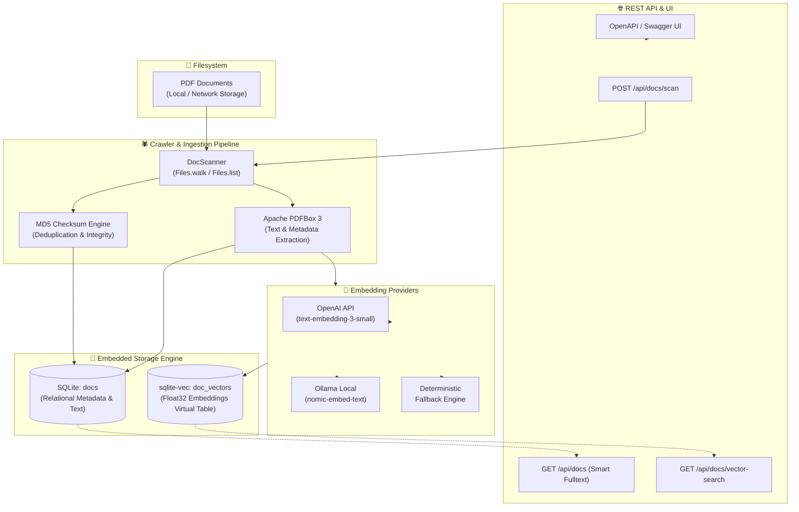

<div align="center">

# 🕷️ ZDocSpider

### High-Performance Document Spider & Local Semantic Vector Search Engine

[](https://openjdk.org/)
[](https://spring.io/projects/spring-boot)
[](https://github.com/asg017/sqlite-vec)
[](http://localhost:8080/swagger-ui.html)
[](LICENSE)
[](CONTRIBUTING.md)

<p align="center">
  <b>ZDocSpider</b> is a modern, lightweight, self-hosted document indexing and semantic retrieval engine. It automatically spiders local PDF directories, extracts text and structural metadata, computes cryptographic checksums for deduplication, and indexes embeddings into an embedded <b>sqlite-vec</b> vector database for lightning-fast semantic and hybrid search.
</p>

[Key Features](#-key-features) •
[Architecture](#-architecture) •
[Quick Start](#-quick-start) •
[API Reference](#-api-reference) •
[Configuration](#-configuration) •
[sqlite-vec Extension](#-sqlite-vec-setup) •
[Contributing](#-contributing)

---

</div>

## 🌟 Key Features

- **🚀 Automated Directory Spidering**: Recursively traverses filesystem directories with configurable depth to discover and index PDF documents.
- **📄 Robust Text Extraction**: Powered by **Apache PDFBox 3**, extracting full text, metadata, and document structure with minimal memory overhead.
- **🔒 Checksum-based Deduplication**: Automatically computes MD5 hashes to detect duplicate files, prevent redundant reprocessing, and manage updates.
- **🧠 Native Vector Search (sqlite-vec)**: Uses SQLite's native `sqlite-vec` extension for in-process ANN (Approximate Nearest Neighbor) vector similarity search without requiring heavy external vector databases (Milvus, Pinecone, Qdrant).
- **🔌 Multi-Provider Embeddings**:
  - **OpenAI**: Out-of-the-box support for `text-embedding-3-small`, `text-embedding-3-large`, and `text-embedding-ada-002`.
  - **Ollama**: Compatible with self-hosted local LLMs (e.g., `nomic-embed-text`, `all-minilm`, `bge-m3`).
  - **Zero-Dependency Fallback**: Built-in deterministic mock/fallback embedding generator for offline testing and air-gapped environments.
- **🔍 Hybrid Retrieval Engine**:
  - **Keyword & Smart Phrase Search**: Boolean tokenization with exact quote matching (`"exact phrase"` + multi-term matching).
  - **Semantic Vector Search**: Cosine/L2 distance search over document content or filenames.
- **📦 Zero-Config Embedded Storage**: Single SQLite database file with WAL (Write-Ahead Logging) mode and Flyway database migrations.
- **🌐 Interactive API Documentation**: Pre-configured **Swagger UI / OpenAPI 3** for instant API inspection and interactive testing.
- **🖥️ SPA Ready**: Embedded frontend routing support with customizable CORS policies.

---

## 🏗️ Architecture



---

## 📋 Prerequisites

| Requirement | Supported Version | Notes |
| :--- | :--- | :--- |
| **Java JDK** | `21+` | LTS release with preview features enabled |
| **Build Tool** | `Maven 3.9+` or `./mvnw` | Wrapper included in repository |
| **Operating System** | macOS (Apple Silicon / Intel), Linux (x86_64, aarch64), Windows | OS-matched `sqlite-vec` binary |

---

## 🚀 Quick Start

### 1. Clone the Repository

```bash
git clone https://github.com/zulvani/zdocspider.git
cd zdocspider
```

### 2. Configure Environment

Create an `.env` file or export your API credentials (optional if using deterministic fallback):

```bash
# For OpenAI embeddings
export OPENAI_API_KEY="sk-your-openai-key-here"

# Or configure application.properties (see Configuration section)
```

### 3. Build & Run

Run using the Maven wrapper:

```bash
./mvnw clean spring-boot:run
```

Once started, the server listens on `http://localhost:8080`.

### 4. Explore the Interactive API Documentation

Open your browser and navigate to:
```
http://localhost:8080/swagger-ui/index.html
```

---

## 📡 API Reference

### 1. Scan and Index Documents

Scans a directory path on the local filesystem, extracts text from all PDF files, computes checksums, generates vector embeddings, and stores them in SQLite.

```http
POST /api/docs/scan
Content-Type: application/json
```

#### Request Body
```json
{
  "root_path": "/Users/username/Documents/Reports",
  "deep": true
}
```

| Parameter | Type | Required | Description |
| :--- | :--- | :--- | :--- |
| `root_path` | `string` | **Yes** | Absolute directory path containing PDF files |
| `deep` | `boolean` | No | If `true`, scans subdirectories recursively (Default: `false`) |

#### Example cURL
```bash
curl -X POST "http://localhost:8080/api/docs/scan" \
  -H "Content-Type: application/json" \
  -d '{
    "root_path": "/Users/username/Documents/Reports",
    "deep": true
  }'
```

#### Response (`200 OK`)
```json
{
  "message": "Scanning completed successfully",
  "root_path": "/Users/username/Documents/Reports",
  "deep": true,
  "total_files_found": 15,
  "total_processed": 15,
  "total_failed": 0,
  "docs": [
    {
      "id": "e4b1050a-9d96-41f2-95f0-62e5352c3c12",
      "file_name": "annual-financial-report-2025.pdf",
      "file_path": "/Users/username/Documents/Reports/annual-financial-report-2025.pdf",
      "checksum": "3b719468923a1a9f09199859f936a61e",
      "created_at": "2026-10-13T01:00:00"
    }
  ]
}
```

---

### 2. Full-Text & Smart Phrase Search

Performs paginated search against document contents and file names with smart quoted phrase support.

```http
GET /api/docs?q={query}&page={page}&size={size}
```

#### Query Parameters
| Parameter | Type | Default | Description |
| :--- | :--- | :--- | :--- |
| `q` | `string` | *optional* | Keywords or quoted phrases (e.g. `"annual revenue" quarterly`) |
| `page` | `integer` | `0` | Zero-based page index |
| `size` | `integer` | `10` | Page size (max: `100`) |

#### Example cURL
```bash
curl -X GET "http://localhost:8080/api/docs?q=\"quarterly+revenue\"+2025&page=0&size=10"
```

#### Response (`200 OK`)
```json
{
  "content": [
    {
      "id": "e4b1050a-9d96-41f2-95f0-62e5352c3c12",
      "file_name": "annual-financial-report-2025.pdf",
      "doc_content": "Executive Summary: The quarterly revenue for 2025 exceeded expectations...",
      "file_path": "/Users/username/Documents/Reports/annual-financial-report-2025.pdf",
      "checksum": "3b719468923a1a9f09199859f936a61e",
      "created_at": "2026-10-13T01:00:00"
    }
  ],
  "page": 0,
  "size": 10,
  "total_elements": 1,
  "total_pages": 1,
  "last": true
}
```

---

### 3. Semantic Vector Search

Performs approximate nearest neighbor vector similarity search using `sqlite-vec`.

```http
GET /api/docs/vector-search?q={query}&field={field}&limit={limit}
```

#### Query Parameters
| Parameter | Type | Default | Description |
| :--- | :--- | :--- | :--- |
| `q` | `string` | **required** | Natural language search prompt |
| `field` | `string` | `content` | Vector field to match: `content` or `file_name` |
| `limit` | `integer` | `10` | Maximum number of top nearest neighbors to return |

#### Example cURL
```bash
curl -X GET "http://localhost:8080/api/docs/vector-search?q=cybersecurity+compliance+guidelines&field=content&limit=5"
```

#### Response (`200 OK`)
```json
[
  {
    "doc_id": "e4b1050a-9d96-41f2-95f0-62e5352c3c12",
    "distance": 0.214732
  },
  {
    "doc_id": "a90f12c3-4819-45be-8ee2-7b0f5ef5b810",
    "distance": 0.385491
  }
]
```

---

## ⚙️ Configuration

Configure settings via `src/main/resources/application.properties` or environment variables:

```properties
# Server Configuration
server.port=8080
server.address=0.0.0.0

# SQLite & Storage Settings
spring.datasource.url=jdbc:sqlite:file:zdocspider?enable_load_extension=true&journal_mode=WAL&busy_timeout=5000
spring.datasource.driver-class-name=org.sqlite.JDBC

# sqlite-vec Native Extension
sqlite.vec.enabled=true
sqlite.vec.path=extensions/sqlite-vec/vec0.dylib

# Spring AI ONNX Transformer Embedding Model (Local In-Process)
spring.ai.model.embedding=transformers
spring.ai.embedding.transformer.tokenizer.uri=classpath:/onnx/all-MiniLM-L6-v2/tokenizer.json
spring.ai.embedding.transformer.onnx.model-uri=https://media.githubusercontent.com/media/spring-projects/spring-ai/refs/heads/main/models/spring-ai-transformers/src/main/resources/onnx/all-MiniLM-L6-v2/model.onnx
spring.ai.embedding.transformer.tokenizer.options.padding=true
spring.ai.embedding.transformer.cache.directory=${java.io.tmpdir}/spring-ai-onnx-model

# Embedding Settings (384 dimensions for all-MiniLM-L6-v2)
embedding.provider=transformers
embedding.dimension=384

# Database Migrations
spring.flyway.enabled=true
spring.flyway.locations=classpath:db/migration
```

### Supported Embedding Providers

#### 1. Spring AI ONNX Transformer (Default & Recommended)
High-performance local embeddings using [Spring AI ONNX Transformers](https://docs.spring.io/spring-ai/reference/api/embeddings/onnx.html) running in-process via ONNX Runtime:
```properties
spring.ai.model.embedding=transformers
spring.ai.embedding.transformer.tokenizer.uri=classpath:/onnx/all-MiniLM-L6-v2/tokenizer.json
spring.ai.embedding.transformer.onnx.model-uri=https://media.githubusercontent.com/media/spring-projects/spring-ai/refs/heads/main/models/spring-ai-transformers/src/main/resources/onnx/all-MiniLM-L6-v2/model.onnx
spring.ai.embedding.transformer.tokenizer.options.padding=true
embedding.dimension=384
```

#### 2. OpenAI
```properties
embedding.provider=openai
embedding.dimension=1536
embedding.api-url=https://api.openai.com/v1/embeddings
embedding.api-key=${OPENAI_API_KEY}
embedding.model=text-embedding-3-small
```

#### 3. Ollama (Self-Hosted / Local LLM)
```properties
embedding.provider=ollama
embedding.dimension=768
embedding.api-url=http://localhost:11434/api/embeddings
embedding.model=nomic-embed-text
embedding.fallback-enabled=true
```

#### 4. Deterministic Mock / Offline Mode
```properties
embedding.provider=mock
embedding.dimension=384
```

---

## 🧩 sqlite-vec Setup

ZDocSpider includes pre-compiled binaries in `extensions/sqlite-vec/`:

| Platform | Binary Path | Extension Name |
| :--- | :--- | :--- |
| **macOS (Apple Silicon & Intel)** | `extensions/sqlite-vec/vec0.dylib` | `vec0.dylib` |
| **Linux (x86_64)** | `extensions/sqlite-vec/vec0-linux-x86_64.so` | `vec0-linux-x86_64.so` |
| **Windows / Custom** | Download from [sqlite-vec Releases](https://github.com/asg017/sqlite-vec/releases) | `vec0.dll` / `vec0.so` |

If you are running on Linux or Windows, update `sqlite.vec.path` in `application.properties`:
```properties
# For Linux:
sqlite.vec.path=extensions/sqlite-vec/vec0-linux-x86_64.so

# For Windows:
sqlite.vec.path=extensions/sqlite-vec/vec0.dll
```

> **Note**: The SQLite JDBC driver connection URL must contain `enable_load_extension=true` (already configured by default in `application.properties`).

---

## 📂 Project Structure

```text
zdocspider/
├── extensions/
│   └── sqlite-vec/              # Native vector extension binaries
│       ├── vec0.dylib           # macOS binary
│       └── vec0-linux-x86_64.so # Linux x86_64 binary
├── src/
│   ├── main/
│   │   ├── java/com/goota/zdocspider/
│   │   │   ├── config/          # Security, OpenAPI, CORS configuration
│   │   │   ├── controller/      # REST API endpoints (DocController, SpaController)
│   │   │   ├── model/           # Entities and Data Transfer Objects (DTOs)
│   │   │   ├── repository/      # Spring Data JPA repositories
│   │   │   └── service/         # Document scanning, PDFBox parsing, embeddings, sqlite-vec
│   │   └── resources/
│   │       ├── application.properties
│   │       └── db/migration/    # Flyway database migration scripts
│   └── test/                    # Integration and unit tests
├── frontend/                    # Web UI assets & optional SPA build
├── pom.xml                      # Maven project configuration
└── README.md                    # Project documentation
```

---

## 🧪 Testing

Execute the complete test suite including sqlite-vec integration tests:

```bash
# Run unit & integration tests
./mvnw test

# Run a specific test
./mvnw test -Dtest=SqliteVecIntegrationTest
```

---

## 🛠️ Tech Stack

- **Language**: [Java 21](https://openjdk.org/)
- **Framework**: [Spring Boot 4 / 3.4](https://spring.io/projects/spring-boot) (Spring Web MVC, Spring Data JPA, Spring Security)
- **Document Engine**: [Apache PDFBox 3.0](https://pdfbox.apache.org/)
- **Vector Database**: [sqlite-vec](https://github.com/asg017/sqlite-vec)
- **Relational Database**: [SQLite](https://www.sqlite.org/) via `sqlite-jdbc` & `hibernate-community-dialects`
- **Database Migrations**: [Flyway](https://flywaydb.org/)
- **API Documentation**: [SpringDoc OpenAPI 3 / Swagger](https://springdoc.org/)
- **Build Tool**: [Apache Maven](https://maven.apache.org/)

---

## 🤝 Contributing

Contributions are warmly welcomed! To get started:

1. **Fork** the repository.
2. **Create a branch** for your feature or bug fix:
   ```bash
   git checkout -b feature/amazing-feature
   ```
3. **Commit** your changes following standard commit conventions:
   ```bash
   git commit -m "feat: add support for docx document indexing"
   ```
4. **Push** to your fork:
   ```bash
   git push origin feature/amazing-feature
   ```
5. **Open a Pull Request** describing your changes.

Please ensure all existing tests pass and add unit tests for new functionality.

---

## 📄 License

This project is open-source and distributed under the [Apache License 2.0](LICENSE).

---

<div align="center">
  <sub>Engineered with precision for fast, local-first document indexing and semantic intelligence.</sub>
</div>
